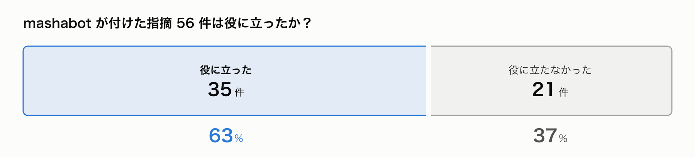
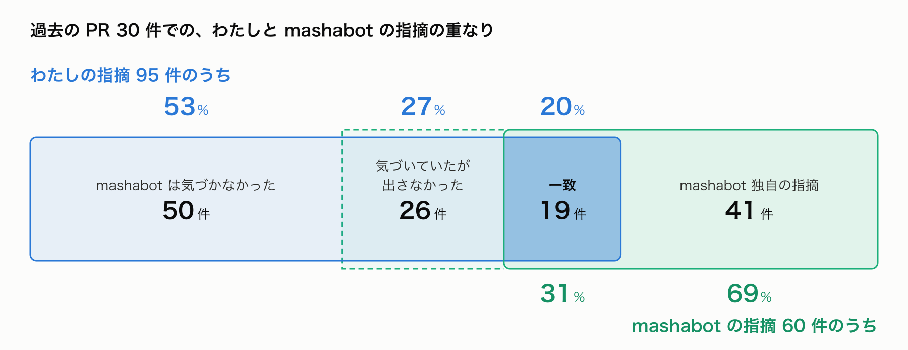

こんにちは、レビューに追われている mashabow です。レビューはもともとわたしの好きな作業ですし、社内のフロントエンドチームの中では一番得意なつもりです。自分で言うのもなんですが。ただ、もうスピードが追いつきません。

もちろん、GitHub Copilot によるレビューも活用しています。以前と比べて Copilot も賢くなりましたよね。しかし、それでもまだカバーできない箇所（つまり、人間のレビューが必要な箇所）はたくさんあります。前提知識やコンテキストがどうしても不足していますし、俯瞰的な視点も弱い印象です。

わたしの分身がどんどんレビューしてくれたらいいのに。

ということで、わたし mashabow の観点で PR をレビューする Claude Code のスキル「mashabo**t**」を試しに作ってみました。この記事はその中間報告です。

先に結果を書いておくと、mashabot の指摘の 6 割は役に立つもので、誤った指摘はほとんどありませんでした。その一方で、わたしっぽい指摘を再現できたのは 2 割にとどまり、分身と呼ぶにはまだほど遠い状態です。

なお、この記事はわたし（人間の mashabow）が書いています。

## mashabot の作り方

「どうやったらいいレビューができるようになるんでしょうか？」と、1on1 でよく質問を受けます。ぜひともサポートしてあげたいところなんですが、今までうまいこと伝えられずにいました（すみません 🙇）。自分の中でいつの間にか少しずつ培われたものなので、客観的な言語化が難しいんですよね。観点別のチェックリストがあるわけでもなく、ある意味無意識的にレビューしています。

しかし、これを言語化しないことにはスキルは作れません。そこで、Claude にお願いして言語化してもらいました。以下の作業は Claude と相談しながら進めたもので、実際に手を動かしたのは Claude です。

### 1. 過去のレビューコメントから観点や書き方を抽出する

まず、過去のわたしのレビューコメントをガッと集めました。2024 年 1 月〜2026 年 9 月の PR 1,067 件が対象です。わたしのレビューコメント 4,311 件から、40 字未満の短いレビューコメントを除外し、残りの 3,721 件を分類しました。繰り返し出てくる指摘をグルーピングしたところ、ここから 60 個ほどの「観点」が得られました。以下はその一部です。

> - PR 本文・コミットメッセージ・コメントに書かれた原因や根拠が、事実として正しいか。症状を抑える回避策ではなく、根本原因を直しているか
> - 「別 PR で」「一旦」「あとで確認する」とするとき、その理由と、どこで対応するか（TODO コメント・issue・PBI）が書かれているか
> - 変更・削除で不要になったもの（依存・設定・export・翻訳キー・モック・story・CSS・画像・解決済みの TODO）を消しているか
> - このリポジトリの他の箇所・他のアプリではしていない書き方をしているとき、その理由がコード中に書かれているか
> - 1 つの語が、同じ PR・同じファイルの中で別々のものを指していないか（「送信」が submit の試みと API リクエストの両方を指す、など）
> - `enabled` のような意味の広い語を、もっとはっきりした語にできないか。名前に悩むときは、インターフェイスの方に問題がないか
> - 型や API の仕様で起こりえないケース・サポート外の環境のために、エラー処理・分岐・保険を入れてコードを複雑にしていないか。まだ使わない汎用化を先回りしていないか
> - 仕組み（独自の prop・型・設定）を足す理由が、ごく一部の箇所の要件だけで成り立っていないか。その要件の側（UI・文言）を変えれば、仕組みを足さずに既存のもので済まないか。PR 本文の「〜できないため」という前提そのものを疑う
> - 実装が Figma どおりでも、既存の共通部品や他の画面の同種の UI と見た目・構造が違うなら、Figma の側を共通部品に寄せた方がよくないか考える
> - テストが要件だけを、ユーザーから見えるもの（role・テキスト）で確かめているか。偶然のふるまいや実装の詳細をアサーションしていないか

なお、実際には、参考となる PR の例も各観点に添えられています。

読んでみるとどれももっともそうですし、たしかにわたしが普段意識していることです。ただ、「こんな簡単な説明でうまく動くのか…？」という気もしてきますね。ちなみに、次のようなものは観点から外しています。

- lint や `CLAUDE.md` の規約によって機械的にカバーできるもの
- 今は使っていないライブラリに関するもの

またついでに、かき集めたレビューコメントから、わたしっぽい書き方を抽出しました。これも抜粋しておきます。

> - です・ます調。硬すぎず、同僚に話しかける調子で書く（「〜ですかね？」「〜でいいんじゃないでしょうか？」）
> - 確信があるものは言い切る。確信がないものは質問の形にし、確認していない範囲を書く（「ちゃんと確認してませんが 🤔」）
> - 意図が読み取れないときは、先に質問する（「〜って何のためのものでしょうか？」「この差異は意図したものですか？」）。自分が分かっていないことは分かっていないと書く
> - 良くなった点には一言添える（「すっきりしましたね ✨」「〜のはいいですね 👍」）
> - 許容するときは、許容する理由と範囲を書く（「〜なので、これでも許容なのかなとは思います」）
> - `（別 PR で OK）`: 直してほしいが、この PR でなくてよい
> - `（細かい話）` / 「細かいですが、」: 軽い指摘
> - 💭: 思いつき・つぶやき。対応を求めない
> - スコープの粒度は PR / PBI / issue の 3 段階ある。「この PBI の中できれいになっていれば OK」のように、どこまでに直してほしいかを添える
> - 既存コードは、コミット SHA 付きの permalink で示す
> - ロジックの誤りは、反例（具体的な入力と結果）で示す
> - 設計の分かれ目では、案を A / B で並べ、それぞれのメリット・デメリットを書いて、どちらがよいと思うかまで書く

うん、たしかにそんな感じだわ。

### 2. レビューの手順を組み立ててスキルにする

観点と書き方が揃ったところで、それを使ってレビューする手順を Claude Code のスキルにしました。以下のように呼び出すイメージです。

```
/mashabot <PRのURLか番号>
```

これをいくつかの PR で動かしてみて、調整を加えた結果、ざっくりと以下のような動きになりました。

1. **レビュー観点**と**コメントの書き方**を読み込む
2. PR の本文・関連 Issue・既存のやり取り・差分を読む
3. UI の変更があれば、実装を Figma のデザインと比べる
4. 変更漏れや既存のコードとのずれがないか、差分の外も `git grep` で調べる
5. **レビュー観点**に沿って指摘を洗い出す
6. 指摘しようとしている内容が本当に正しいか確かめる。確信の持てないものは省略するか、PR 作者への質問にする
7. **コメントの書き方**に沿って文面を書き、PR に未送信（pending）のレビューとして付ける
8. チャットで指摘の一覧と、出さなかった候補を報告する

このスキルを動かすと、レビューをして以下のように報告してくれます。


ちなみに、人間のコメントと区別できるように、コメントには `mashabot 🤖` という署名を入れています。


現状のわたしの使い方は、以下のとおりです。

1. Claude Code の新しいセッションを作り、`/mashabot` を実行
2. mashabot が付けたコメントをざっと確認して投稿
3. そのセッションの中で対話しながら、人間としてのレビューをする
4. [任意] 観点をさらに改善できないか Claude に聞き、更新してもらう

:::message
**Tips：手順はリポジトリに、観点は Notion に置く**

スキルの本体はリポジトリ内に置いてあり、手順はそこに書かれています。一方、レビューの観点については Notion に置き、MCP で読み込ませることにしました。というのも、観点はできるだけ気軽に、こまめに改善していきたいからです。

関連：[Agent Skillは振る舞いとナレッジを分けて設計する](https://zenn.dev/socialplus/articles/f5d9e28470eb99)
:::

## mashabot は活躍できているのか

さて、目論見はうまくいっているんでしょうか？ mashabot を数週間使ったところで、次の 3 つを調べてみました。

- mashabot は真っ当なレビューができているのか？
- mashabot のレビューはわたし本人っぽいか？
- 1 PR あたりにかかる費用と時間は？

なお、いずれの指標も Claude でざっくり算出した値であることに注意してください。

### mashabot は真っ当なレビューができているのか？

レビューのためのスキルなので、的外れなレビューをされては困ります。mashabot が付けた指摘 56 件（PR の数としては 34 件）に対して、最終的にどのように決着したのか追跡し、役に立ったか否かを判定したところ、以下のようになりました。



- **6 割は役に立った指摘**。指摘が受け入れられ、修正や改善につながったもの。
- **4 割は役に立たなかった指摘**。論理的には正しいけど細かすぎる指摘だったり、過剰な配慮だったりで、対応不要だと判断されて受け入れられなかったもの。また、PR の方針そのものが途中で変わり、無用になった指摘も含む。なお、誤った指摘はほとんどなかった。

まだお試しなのでそこまで期待していなかったんですが、意外と真っ当なレビューができているようです。Claude の賢さによる部分も大きそうですね。以下は役に立った指摘の例です。


*Figma の仕様メモと実装の食い違いを指摘し、合意済みなのか質問*


*コードコメントと実際の挙動のずれを指摘し、対応方法を提案*

役に立たなかった指摘の多くは「細かすぎる」ものでした。たとえば、以下のようなものです。

- 他と比べて丁寧すぎる対応を求めていた
- そのうち消えるコードに対して、妥協せず品質を求めていた


*値の根拠をコメントに残すよう求めたが、不要だと判断された*

「わざわざそうするだけの価値があるか？」という判断が、mashabot はまだ弱いようです。

### mashabot のレビューはわたし本人っぽいか？

mashabot の発端は「わたしの分身ができないか？」でした。そこで、本当に分身になれているのかを確認します。

mashabot がわたしの分身となり、わたしの観点でレビューしていたとしたら、わたしと同じ指摘をしてくれるはずです。というわけで、mashabot 導入以前にわたしがレビューした PR 30 件を mashabot にレビューさせ、指摘の内容を比較してみました。バックテストですね。

その際の注意点ですが、過去の PR をそのまま単純にレビューさせてしまうと、公平な比較になりません。過去の PR は、レビューのやり取りの中でコメントが付いたりコミットが積み重なったり、内容が変わっているからです。わたしがレビューを始めた時点（「👀」とコメントする習慣があります）の状態を復元して、mashabot にレビューさせる必要があります。

わたしの指摘 95 件と mashabot の指摘 60 件を集め、「同じ箇所に対して、同じ内容の指摘をしているか」の一致度を判定しました。部分的な一致は 0.5 件としてカウントし、これらの判定は Claude に任せています。なお、書き方（文体など）は考慮に入れていません。

結果は次のとおりです。



- わたしがした指摘のうち、mashabot も同じように指摘できたのは 2 割
  - 「mashabot が気づいてはいたけど、コメントとしては出さなかったもの」も含めると、5 割近くまで増える
- mashabot がした指摘のうち、わたしも同じように指摘していたのは 3 割

うーん。まだまだ分身とは言えませんね。

:::message
mashabot のレビュー観点は、もともとわたしの過去のレビューから抽出したものです。つながりが明らかな PR（例：レビュー観点の中に PR 番号が出てくる）については、バックテストの対象から除外しましたが、それでも間接的には mashabot に有利に働いている可能性があります。

本来であれば訓練用のデータとは別に、あらかじめテスト用のデータを取り分けておくべきですが、評価のことを考えずに無計画に作ってしまいました 😅
:::

mashabot がした指摘の中には、わたしの指摘にかなり似通ったものもありました。特に、「こう書いたら良いのでは？」という提案は、再現性が高いようです。次の例では直し方だけでなく、「既存のテストでは使っていない」という根拠まで一致しています。

**わたしの実際の指摘**

> こういうモック設定の重ねがけは、動作が追いづらくなるのでなるべく避けたいです。既存のテストファイルでも、`server.resetHandlers()` を使っている箇所はありません。
>
> `describe` で契約あり・未契約をグループ化して、その中でモックを設定するといいんじゃないでしょうか？

**バックテストでの mashabot の指摘**

> `beforeEach` で全テストに契約ありのモックを入れ、未契約のテストだけ `server.resetHandlers()` で取り除く、という形になっていて、未契約のテストを読むときに `beforeEach` と打ち消しの両方を追う必要があります。app 内の spec で、テストの中で `server.resetHandlers()` を呼んでいるのはここだけでした。
>
> 契約ありのテストを `describe` にまとめて、その中の `beforeEach` で `server.use(getEnterpriseHasTrackingOption)` するようにすれば、打ち消しもコメントも要らなくなりそうです。
>
> （引用者注：コード例は省略）
>
> mashabot 🤖

しかしその一方で、**mashabot は「前提を疑う」ことが苦手**なようです。わたしがレビューする際は、「PR 本文に書いてある動機（Why）は筋が通ってる？」「そもそもこの PR は必要？」というように、最初に前提を疑って読んでいきます。

たとえば、「外部のスクリプトによって `Error` クラスが差し替えられた場合、その環境で起きたエラーの取り扱いがうまくいかないので、改善する」という PR がありました。この PR に対して、わたしは最初に

> そもそもなんですが、こういったイレギュラーな状況に真面目につきあう必要ってありますか？

と作者に必要性を問いかけました。最終的には不要だということで合意し、クローズされています。

一方の mashabot は、まず `Error` クラスがどのように差し替えられているのかを推測し、手元で再現して試した上で、実装に関する指摘をいくつか付けていました。指摘の中身自体は筋が通っていたのですが、そもそも PR 自体が不要なのであれば、細部を議論する価値はありません。

このような「前提を疑う」姿勢が、いまの mashabot にはどうも足りていないようです。

### 1 PR あたりにかかる費用と時間は？

費用と時間も念のため確認しておきます。Claude Code のログから算出した値です。

| | 中央値 |
| --- | --- |
| 費用（従量課金換算[^1]） | 約 1.4 ドル |
| 実行時間 | 約 2.6 分 |

[^1]: Opus 5.5 の単価で計算。実際には Team プランの枠の中で利用しています。

PR の大きさによって幅はありますが、1 PR あたり数ドル・数分程度です。これぐらいの費用であれば、やりくりを考える必要もなさそうです。実行時間の面でも、GitHub Copilot と遜色ありません。

## mashabot のこれから

ここまでの検証で、**mashabot はそこそこ使い物にはなるが、わたしの分身にはまだほど遠い**ということがわかりました。もっと使い物になるように改善して、レビューを代わってもらいたいところです。

### 弱点の補強

今の mashabot に大きく不足しているものは、以下の 2 つの視点です。

- 指摘として細かすぎないか？ 指摘に対応するだけの価値があるか？
- PR に書かれている前提は正しいか？ 批判的に読めているか？

前者については、mashabot を引き続き使って反応をフィードバックしてやることで、「細かすぎ」の感覚が人間と揃ってくるかもしれません。あるいは「人間の感覚に揃える」という旧来の前提を捨てて、「細かすぎかどうかなんて、そんな細かい話は AI 任せでよくない？」という方向もありそうです。

後者については、どこまで前提を疑えるんでしょうか？ 前提を疑うためには、往々にして PR の外のコンテキストが必要です。結局のところ、「このコンテキストをどこまで mashabot と共有できるか？」という話になるかもしれません。mashabot 側にも工夫の余地はあるとは思いますが、開発全体の視点でアプローチできるとよさそうです。

### 運用の見直し

今はローカルの Claude Code で `/mashabot` を実行しています。今回の検証でそこそこ使い物になることがわかったので、PR が ready になったタイミングで、自動で mashabot によるレビューをしたいですね。

さらに、「PR がマージされたらふりかえって観点を改善」というのも自動でやっておいてほしいところです。

### 評価手法の改善

今回は以下の 3 つの側面から、mashabot をざっくり評価しました。

- mashabot は真っ当なレビューができているのか？（指摘内容の正当性）
- mashabot のレビューはわたし本人っぽいか？（指摘内容の再現性）
- 1 PR あたりにかかる費用と時間は？（コスト）

しかし「mashabot にレビューを任せられるか？」という点を考えると、これだけではまだ不十分です。人間や GitHub Copilot、Claude Code 組み込みの [`/code-review`](https://code.claude.com/docs/ja/code-review-local) などを相手に、性能を比較するとおもしろそうです。

「分身がレビューしてくれたら」という話でいうと、いずれは `mashabot 🤖` の署名を外して、チューリングテスト的なことをしてみたいですね。果たしてこのコメントを書いたのは mashabot なのか、それとも人間の mashabow なのか。

## おわりに

幸か不幸か、人間がやるべきレビューの仕事はまだあるようです。でも先は分かりません。どうなるんでしょうね。
